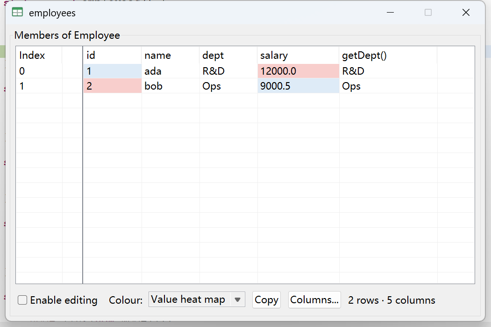

# ValueTable

[简体中文](README.md) | **English**

An Eclipse plug-in that shows a debug variable or a watch expression as a table, so a `List<Employee>`, a `Map`, or a `double[][]` can be read by scrolling and sorting with your eyes instead of expanding nodes in the Variables view.



## What it does

* **Any variable, as a table.** Select it in the Variables view, in Inspect, or as a watch expression, and pick *Show as Table* (`Ctrl+Alt+V`). Arrays, `Map`, collections, and lists of your own objects all work.
* **Lists of objects need no configuration.** The columns are the instance fields of the element type - supertypes included, static fields excluded. No-argument getters can be added per preference, because every getter cell is a call into the target VM.
* **Column picker.** *Columns...* in the table window writes one rule per type (`com.demo.Employee#id,name,salary`), so a table can show exactly the members that matter, in the order you want.
* **Paged, not copied.** The first page is 100 x 100 cells; the next page is read when a scroll bar reaches its end. A 10000 x 10000 matrix costs what is on screen.
* **Frozen row labels.** The index column is its own table pinned to the left, because SWT cannot freeze a column.
* **PyCharm-style colouring.** Numeric columns get a red/white/blue heat map scaled to their own range; everything else can be striped.
* **Cell editing, opt-in.** *Enable editing* is off by default, so a stray double click cannot change the program. A `null` row is shown grey and cannot be edited.
* **Excel-style copy.** Drag a rectangle and `Ctrl+C` copies it as tab-separated text. With nothing selected, the whole loaded table is copied.
* **Nothing runs on the UI thread.** Every read is a `Job` serialised per debug target, so a slow target never freezes Eclipse.

## Safety

Reading a cell can mean executing code inside the target VM, which is the one thing that can hang a debug session. The plug-in treats that as a first-class problem:

* method calls can be switched off entirely;
* a fixed list of blocking or session-ending methods (`wait`, `notify`, `join`, `sleep`, `lock`, `close`, `shutdown`, `exit`, ...) is never called, and the list cannot be disabled;
* user-defined blacklist;
* before every call the guard checks whether another *suspended* thread owns the object's monitor. JDI evaluates with `INVOKE_SINGLE_THREADED`, so such a call could never return - it is skipped and reported.

A skipped call only changes what a value looks like; it is reported in the warning strip under the table, never silently.

## Requirements

* Eclipse 2023-06 or newer (built and tested against 2025-06), Java 17 or newer
* The debugger: this is a JDT debug plug-in, so JDT must be present

## Install

**From the update site** (recommended): *Help > Install New Software… > Add*,
enter `https://qimu55kai.github.io/com.value.table/`, pick **ValueTable**, and
restart.

> Untick **Contact all update sites during install to find required software**.
> The plug-in only uses JDT / UI bundles that the platform already has, so there
> is nothing to go looking for. Left ticked, p2 may swap a hundred-plus platform
> bundles for a different release train along the way, and things like eclemma
> and the product branding break with it.

**Into dropins**:

1. Copy `com.value.table_1.0.0.jar` into `<eclipse>/dropins/`.
2. Restart Eclipse completely. (Replacing the jar under a running Eclipse breaks that instance until it is restarted - the window shows its build time in the bottom right corner, which is the quickest way to tell which jar is live.)

Or import this project into Eclipse as a plug-in project and use *Export > Deployable plug-ins and fragments*.

## Usage

| Where | What |
| --- | --- |
| Variables view, right click | *Show as Table* |
| Variables view, toolbar | the ValueTable button |
| Anywhere in the window | `Ctrl+Alt+V` |
| Expressions view, double click a row | opens the table of that value |
| Table window, `Ctrl+C` | copies the dragged block as TSV |
| Table window, double click a cell | edits it, if *Enable editing* is ticked |

## Preferences

`Window > Preferences > Java > Debug > ValueTable`

* **Rules** - the `class & arrayGetter & rowName & colName` table. Needed only for types that are neither arrays nor `Iterable`/`Iterator`; *Help* in the page documents the syntax, including `[m1,m2()]` for "one row is these members", which is what makes a `Map` read as two columns.
* **Columns per type** - the lines the column picker writes. Kept as editable text on purpose: they are easy to copy between workspaces.
* **Calls into the debug target** - method calls on/off, getter columns, monitor guard, blacklist, timeout, row limit.
* **Language** - system, Chinese, or English. Applied at start-up.

## Build

**The update site** (Tycho; needs JDK 17+, Maven comes from the wrapper):

```sh
./mvnw -f releng/pom.xml clean package
```

The result is `releng/com.value.table.site/target/repository/` - a p2 repository
(`content.jar`, `artifacts.jar`, `features/`, `plugins/`). Serve it from any
HTTPS directory and that URL is an update site. Pushing a `v*` tag has GitHub
Actions build and publish it to `gh-pages`; see
[docs/marketplace.md](docs/marketplace.md).

**A single jar** (for `dropins/`): *Project > Export > Deployable plug-ins and
fragments* in Eclipse, or the `_build/build.sh` of the development workspace
(compile, stamp the build time, package, install), which is not part of this
repository.

## Layout

```
src/com/value/table/
  model/                     debug model access, rules, paging - no widgets
  show/                      windows and dialogs - no JDI on the UI thread
  preferences/  handlers/  util/
  messages.properties        English text (base bundle)
  messages_zh_CN.properties  Chinese text
plugin.properties            text the platform reads from plugin.xml - English only
help.txt / help_zh_CN.txt    rule syntax, one file per language
icons/  META-INF/  plugin.xml  build.properties
pom.xml                      the plug-in itself (Tycho reads MANIFEST from here)
releng/                      feature, update site, release engineering
docs/marketplace.md          how it is listed on Eclipse Marketplace
.github/workflows/           build and publish the update site on a tag
```

## Adding a language

1. Copy `messages.properties` to `messages_<locale>.properties` and translate the values. The keys must stay identical - the tests compare the key sets.
2. Copy `help.txt` to `help_<locale>.txt`.
3. Add the language to `Messages#systemLocale` / the preference page if it needs special fallback handling (Chinese does: every `zh_*` locale maps to `zh_CN`, so Hong Kong, China / Macao, China / Taiwan, China do not fall back to English).

`plugin.properties` is deliberately left alone. It is read by the extension registry, and the registry chooses a translation by the platform-wide `-nl` locale - not the language picked on this plug-in's preference page, and not changeable without restarting the IDE. Translating it produced a Chinese context menu entry and toolbar tooltip in front of an English table window (or the reverse), so the way into the window stays English and only the window follows the preference. The file has to stay ISO-8859-1: `Properties.load` reads bytes, not UTF-8.

## Limitations

* A JDI call has no timeout and cannot be cancelled. The monitor guard predicts the common deadlock, but code that blocks for another reason still blocks its own job - only that table, not Eclipse.
* Dragging a selection past the last loaded row does not load more.
* `List<Animal>` holding `Dog` objects shows Animal's columns only; a Dog column would be empty on every Cat row.

## License

Eclipse Public License 2.0 - see [LICENSE](LICENSE).
